# Donor Churn Prediction System

A beginner-friendly machine learning project that predicts whether an existing donor of a nonprofit
organisation is likely to **stop donating** ("churn"). It is built with Python, Pandas, NumPy,
Scikit-learn, Matplotlib and Seaborn.

> **Educational simulation.** This project is *inspired by* nonprofit fundraising use cases such as
> those of UNICEF, but **all data is synthetic** (computer-generated). It does not contain, represent
> or describe real UNICEF donors or any real organisation or person.

---

## Table of contents

1. [Project introduction](#1-project-introduction)
2. [The real-world problem: donor retention](#2-the-real-world-problem-donor-retention)
3. [Machine learning concepts used](#3-machine-learning-concepts-used)
4. [The dataset](#4-the-dataset)
5. [Feature descriptions](#5-feature-descriptions)
6. [Installation](#6-installation)
7. [Virtual environment setup](#7-virtual-environment-setup)
8. [Running the project](#8-running-the-project)
9. [The complete workflow, simply explained](#9-the-complete-workflow-simply-explained)
10. [Results](#10-results)
11. [Evaluation metrics explained](#11-evaluation-metrics-explained)
12. [Making predictions](#12-making-predictions)
13. [Running the tests](#13-running-the-tests)
14. [Visualization gallery](#14-visualization-gallery)
15. [Project structure](#15-project-structure)
16. [Limitations and ethical considerations](#16-limitations-and-ethical-considerations)

---

## 1. Project introduction

The **Donor Churn Prediction System** looks at a donor's history (how often they give, how recently they
gave, how engaged they are with emails and campaigns, and so on) and estimates how likely they are to
stop donating in the next 12 months.

The project shows a complete, realistic machine learning workflow:

* generating a reproducible synthetic dataset,
* checking data quality and exploring the data (EDA),
* building a leak-free preprocessing + model **pipeline**,
* training a **Logistic Regression** classifier,
* evaluating it honestly on data it has never seen,
* saving the model and using it to score new donors,
* and testing everything automatically with `pytest`.

## 2. The real-world problem: donor retention

Nonprofits depend on donors who give again and again. Keeping an existing donor is usually much cheaper
than finding a new one. If a fundraising team knows **which donors are at risk of leaving**, it can act
early, for example with a thank-you call, an impact update, or an invitation to switch to a monthly gift.

But retention resources (staff time, mailings, phone calls) are limited. A churn model helps the team
**prioritise**: contact the donors most likely to leave, instead of contacting everyone or no one.

## 3. Machine learning concepts used

| Concept | Simple explanation | Where in the code |
|---|---|---|
| **Supervised learning** | The model learns from examples where the answer is already known (we know which past donors churned). | `src/train.py` |
| **Binary classification** | The answer has two possible values: `0 = Active`, `1 = Churned`. | whole project |
| **Logistic Regression** | A simple, explainable model that turns a weighted sum of the features into a probability between 0 and 1. | `src/train.py` |
| **Train/test split** | We hide 20% of the donors during training and use them only at the end to check performance on "new" data. | `src/preprocess.py` |
| **Stratification** | The split keeps the same churn percentage in the training and test sets. | `split_train_test()` |
| **Data preprocessing** | Filling missing values, scaling numbers and converting text categories to numbers. | `build_preprocessor()` |
| **Feature engineering** | Turning raw columns into model-ready inputs: scaling numeric features, one-hot encoding `donation_frequency`, and excluding the `donor_id` identifier. | `src/preprocess.py` |
| **Pipeline** | Preprocessing and the model are glued together so they are always fitted and applied in the same way. | `build_model_pipeline()` |
| **EDA** | Exploring the data with statistics and charts before modelling. | `src/eda.py`, notebook |
| **Model evaluation** | Accuracy, precision, recall, F1-score, confusion matrix, ROC-AUC. | `src/evaluate.py` |
| **Prediction probability** | The model gives a churn probability, which we turn into a Low / Medium / High risk level. | `src/predict.py` |
| **Model saving and loading** | The trained pipeline is stored in one file with Joblib and reloaded for predictions. | `src/model_io.py` |

### What is data leakage, and how is it prevented?

*Data leakage* happens when information the model should not have during training sneaks into it,
making results look better than they really are. This project prevents it in three ways:

1. **Fit on training data only.** The imputers (which learn medians / most frequent values), the scaler
   (which learns means and standard deviations) and the one-hot encoder are inside the pipeline and are
   fitted **only on the training rows**. The test rows are only *transformed*, never learned from.
   A test (`test_preprocessing_is_fitted_on_training_data_only`) checks this.
2. **No future information.** Every feature describes the donor *as of a snapshot date*. The churn label
   describes what happens *after* that date. No feature is computed from the future window.
3. **No identifiers.** `donor_id` is never used as a model feature.

### Why stratify the train/test split?

Only about **1 in 4** donors in this dataset churn - the classes are *imbalanced*. With a purely random
split, the test set could by chance contain, say, 20% or 30% churners, which would make the evaluation
noisy and unfair. `stratify=y` guarantees that the training set and the test set both contain the same
churn percentage (25.6% in each here), so the model learns from, and is judged on, a representative sample.

### Why `class_weight="balanced"`?

Because active donors are the majority, a lazy model could predict "Active" for everyone and still get
about 74% accuracy - while catching **zero** churners. `class_weight="balanced"` tells Logistic Regression
to treat mistakes on the smaller class (churners) as more costly, so it actually learns to find them.

## 4. The dataset

The dataset is created by `src/generate_dataset.py` with a fixed random seed (`42`), so it is the same
every time. It contains **5,000 donors** and 13 columns, saved to `data/raw/donors.csv`.

### How the churn label is generated (assumptions)

The generator follows common fundraising experience. Each donor gets a **true churn risk** from a
logistic formula:

| Driver | Effect on churn risk |
|---|---|
| More days since last donation | strong **increase** |
| Higher email open rate | decrease |
| Higher campaign response rate | decrease |
| Recurring donor (`1`) | strong **decrease** |
| Longer donor tenure | decrease |
| Previously lapsed (`previous_churn_flag = 1`) | increase |
| Older age | small decrease |
| Hidden "engagement" (not given to the model) | decrease |
| Random "life events" (not given to the model) | unpredictable |

To make the problem realistic rather than perfectly predictable:

* the label is **sampled** from the risk (a weighted coin flip), so two donors with identical features can
  have different outcomes (class overlap),
* two drivers are **hidden** from the model,
* the intercept is calibrated so that about **25%** of donors churn (class imbalance),
* about **2%** of `age`, `email_open_rate` and `campaign_response_rate` values and **1%** of
  `donation_frequency` values are removed at random, so the pipeline has missing values to handle.

Features are also realistically correlated with each other: for example, monthly donors are more often
recurring donors, give smaller amounts per gift, and have shorter gaps between gifts.

Summary of the generated data (from `python -m src.generate_dataset` / `python -m src.eda`):

| | Value |
|---|---|
| Total donors | 5,000 |
| Active donors | 3,721 (74.4%) |
| Churned donors | 1,279 (25.6%) |
| Missing cells | 362 (age 98, donation_frequency 50, email_open_rate 108, campaign_response_rate 106) |
| Duplicate rows / duplicate IDs | 0 / 0 |

## 5. Feature descriptions

| Column | Type | Description | Used by model? |
|---|---|---|---|
| `donor_id` | text | Unique donor identifier (e.g. `D10001`). | **No** (identifier only) |
| `age` | number | Donor age in years (18-90). | Yes |
| `donation_count` | number | Number of donations made so far. | Yes |
| `total_donated` | number | Lifetime donation amount in dollars. | Yes |
| `avg_donation` | number | Average donation amount (`total_donated / donation_count`). | Yes |
| `days_since_last_donation` | number | Days since the most recent donation (capped at 1,095 = 3 years). | Yes |
| `donation_frequency` | category | Usual giving rhythm: `Monthly`, `Quarterly` or `Yearly`. | Yes (one-hot encoded) |
| `donor_tenure_months` | number | How long the donor relationship has lasted, in months. | Yes |
| `email_open_rate` | number | Percentage of emails opened (0-100). | Yes |
| `campaign_response_rate` | number | Percentage of campaigns responded to (0-100). | Yes |
| `recurring_donor` | 0 / 1 | `1` if the donor gives through an automatic recurring plan. | Yes |
| `previous_churn_flag` | 0 / 1 | `1` if the donor lapsed in the past and was later won back. | Yes |
| `churn` | 0 / 1 | **Target.** `1` = no donation in the 12 months after the snapshot (Churned), `0` = Active. | Target |

How each feature group is preprocessed (inside the pipeline):

* **Numeric** features: missing values -> training **median**, then **StandardScaler** (mean 0, std 1).
* **Binary** features: missing values -> **most frequent** value.
* **Categorical** feature: missing values -> **most frequent** category, then **OneHotEncoder**
  (unknown categories at prediction time are safely ignored).

## 6. Installation

Requirements: **Python 3.11 or newer** (verified with Python 3.12.3).

```bash
# 1. Get the code and open the project root folder
cd donor-churn-prediction-using-python-scikit-learn

# 2. Create and activate a virtual environment (see next section)

# 3. Install dependencies
pip install -r requirements.txt
```

## 7. Virtual environment setup

A virtual environment keeps this project's packages separate from the rest of your computer.

**Linux / macOS**

```bash
python3 -m venv .venv
source .venv/bin/activate
pip install -r requirements.txt
```

**Windows (PowerShell)**

```powershell
python -m venv .venv
.venv\Scripts\Activate.ps1
pip install -r requirements.txt
```

When the environment is active, your terminal prompt usually starts with `(.venv)`.
Run `deactivate` to leave it.

## 8. Running the project

Run every command **from the project root** (the folder that contains `src/` and `README.md`).

| Step | Command | What it does |
|---|---|---|
| Install | `pip install -r requirements.txt` | Installs all libraries. |
| 1. Generate data | `python -m src.generate_dataset` | Creates `data/raw/donors.csv` (5,000 synthetic donors). |
| 2. EDA | `python -m src.eda` | Prints statistics and saves 9 charts to `reports/figures/`. |
| 3. Train | `python -m src.train` | Splits the data, trains the pipeline, saves `models/donor_churn_model.joblib`, prints a summary. |
| 4. Evaluate | `python -m src.evaluate` | Evaluates on the test set, saves the confusion matrix, ROC curve, metrics chart and `reports/model_evaluation.txt`. |
| 5. Predict | `python -m src.predict` | Predicts churn for example donors (single and batch). |
| Tests | `pytest -v` | Runs the automated test suite. |

Optional extras:

```bash
python -m src.preprocess                       # data-quality report + saves data/processed/donors_clean.csv
python -m src.predict --input data/processed/test.csv --output reports/test_predictions.csv
jupyter notebook notebooks/exploratory_analysis.ipynb   # interactive EDA
```

## 9. The complete workflow, simply explained

```
 generate_dataset.py      eda.py                 train.py                         evaluate.py           predict.py
 -------------------      ------                 --------                         -----------           ----------
 Create 5,000        -->  Look at the data  -->  Clean data                  -->  Load model +     -->  Load model,
 synthetic donors         (stats + charts)       Split 80% train / 20% test       untouched test        score new donors,
 data/raw/donors.csv      reports/figures/       Fit pipeline on TRAIN only:      set, compute          return probability
                                                   impute -> scale/encode ->      metrics, save         + risk level
                                                   Logistic Regression            charts + report
                                                 Save models/*.joblib
```

1. **Generate** a realistic synthetic dataset with a fixed seed.
2. **Explore** it to understand distributions, imbalance and relationships.
3. **Clean** it: fix types, drop duplicates, drop rows without a label.
4. **Split** it into 80% training and 20% test data, stratified by churn.
5. **Train** one pipeline (preprocessing + Logistic Regression) on the training data only.
6. **Evaluate** on the test data the model has never seen.
7. **Save** the trained pipeline and **predict** churn risk for new donors.

## 10. Results

These are the actual test-set results produced by `python -m src.train` / `python -m src.evaluate`
(copied from `reports/model_evaluation.txt`; all values are computed from model predictions, nothing is
hard-coded). Because every random step uses a fixed seed, you should get the same numbers.

```
DONOR CHURN PREDICTION
======================

Dataset:
Total Donors: 5,000
Training Samples: 4,000
Testing Samples: 1,000

Model:
Logistic Regression

Evaluation:
Accuracy: 0.758 (75.8%)
Precision: 0.518 (51.8%)
Recall: 0.777 (77.7%)
F1-score: 0.622 (62.2%)
ROC-AUC: 0.834
```

Confusion matrix on the 1,000 test donors:

| | Predicted Active | Predicted Churned |
|---|---|---|
| **Actually Active (744)** | 559 (true negatives) | 185 (false positives) |
| **Actually Churned (256)** | 57 (false negatives) | 199 (true positives) |

**How to read this:** the model found 199 of the 256 donors who really churned (recall 77.7%). To do
that, it also flagged 185 donors who would have stayed anyway, so about half of the flagged donors
really were at risk (precision 51.8%).

> These are test-set results on **synthetic** data. They demonstrate the method; they say nothing
> about the performance of a model on any real organisation's donors.

## 11. Evaluation metrics explained

Every prediction falls into one of four boxes:

* **True positive (TP):** churner correctly flagged.
* **True negative (TN):** active donor correctly left alone.
* **False positive (FP):** active donor wrongly flagged as at risk.
* **False negative (FN):** churner the model missed.

| Metric | Question it answers | Formula |
|---|---|---|
| **Accuracy** | Overall, how many predictions were correct? | (TP + TN) / all |
| **Precision** | Of the donors we *predicted* would churn, how many actually churned? | TP / (TP + FP) |
| **Recall** | Of the donors who *actually* churned, how many did the model identify? | TP / (TP + FN) |
| **F1-score** | One number balancing precision and recall (their harmonic mean). | 2 x P x R / (P + R) |
| **ROC-AUC** | How well does the model *rank* churners above active donors, across all thresholds? 0.5 = random guessing, 1.0 = perfect. | area under the ROC curve |

**Why accuracy is not enough.** With 74% active donors, a model that always says "Active" scores 74%
accuracy but helps nobody. That is why we focus on precision, recall and F1 for the churn class.

**Why recall matters in donor retention.** A false negative is a donor who was about to leave and
received no attention. That is a lost opportunity to keep a supporter (and their future gifts).
High recall means few at-risk donors slip through.

**Why precision matters too.** A false positive is a loyal donor who receives an unnecessary retention
call or mailing. That wastes limited staff time and budget, and too many contacts can even annoy donors.
High precision means retention resources are spent on donors who really need them.

### The precision-recall trade-off

The model outputs a probability. A donor is predicted as "churn" when the probability is at least the
**decision threshold** (0.50 by default). Moving the threshold trades one metric for the other
(actual values from `reports/model_evaluation.txt`):

| Threshold | Donors flagged (of 1,000) | Precision | Recall | F1 |
|---|---|---|---|---|
| 0.30 | 610 | 0.380 | 0.906 | 0.536 |
| 0.40 | 481 | 0.445 | 0.836 | 0.581 |
| **0.50** | **384** | **0.518** | **0.777** | **0.622** |
| 0.60 | 294 | 0.609 | 0.699 | 0.651 |
| 0.70 | 203 | 0.670 | 0.531 | 0.593 |

* **Lower threshold** -> more donors flagged -> higher recall, lower precision (catch more churners,
  waste more effort).
* **Higher threshold** -> fewer donors flagged -> higher precision, lower recall (efficient, but more
  churners missed).

The right threshold is a **business decision**: it depends on the cost of a retention action versus the
value of a retained donor, and on how many donors the team can actually contact.

## 12. Making predictions

### From the command line

```bash
python -m src.predict
```

Example output (actual output from the saved model):

```
Donor ID: D1001
Prediction: Churn Risk
Churn Probability: 96.4%
Risk Level: High
--------------------------------
Donor ID: D1002
Prediction: Churn Risk
Churn Probability: 55.6%
Risk Level: Medium
--------------------------------
Donor ID: D1003
Prediction: Likely to Stay
Churn Probability: 3.8%
Risk Level: Low
```

Score a whole CSV file (it must contain the feature columns; `donor_id` is optional):

```bash
python -m src.predict --input data/processed/test.csv --output reports/test_predictions.csv
```

### From Python

`predict_donor_churn()` accepts **one donor** (a `dict`) or **many donors** (a list of dicts or a
pandas `DataFrame`):

```python
from src.predict import predict_donor_churn, print_predictions

donor = {
    "donor_id": "D2001",
    "age": 41,
    "donation_count": 5,
    "total_donated": 250.0,
    "avg_donation": 50.0,
    "days_since_last_donation": 300,
    "donation_frequency": "Quarterly",
    "donor_tenure_months": 20,
    "email_open_rate": 18.0,
    "campaign_response_rate": 6.0,
    "recurring_donor": 0,
    "previous_churn_flag": 0,
}

result = predict_donor_churn(donor)          # one donor  -> one dict
print(result)
print_predictions(result)

results = predict_donor_churn([donor, donor])  # many donors -> list of dicts
```

Each result contains:

| Key | Meaning |
|---|---|
| `donor_id` | The donor's ID (or `ROW-n` if none was given). |
| `prediction` | `1` = churn risk, `0` = likely to stay (threshold 0.50). |
| `prediction_label` | `"Churn Risk"` or `"Likely to Stay"`. |
| `churn_probability` | Model probability of churn, between 0 and 1. |
| `risk_level` | `"Low"` (< 30%), `"Medium"` (30% to < 60%) or `"High"` (>= 60%). |

> The 30% / 60% risk bands are **illustrative thresholds, not validated fundraising policy**.

## 13. Running the tests

```bash
pytest -v
```

The test suite (68 tests) covers dataset generation (size, unique IDs, valid target, required columns,
reproducibility, realistic relationships), preprocessing (missing values, leakage, validation, cleaning,
stratified split), the model (fitting, valid predictions, probabilities between 0 and 1, metrics
calculated from predictions, save/load), predictions (risk levels, single and batch input, error
handling) and EDA chart generation.

The tests **do not depend on running the scripts first**: fixtures in `tests/conftest.py` generate a
small dataset and train a temporary model, and all test files are written to temporary folders.

## 14. Visualization gallery

All charts are 300 DPI PNG files in `reports/figures/`.

### Exploratory data analysis

**Donor churn distribution**
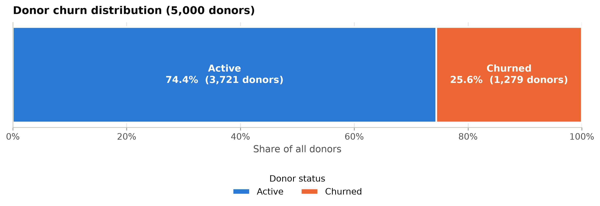

**Active vs churned donors**
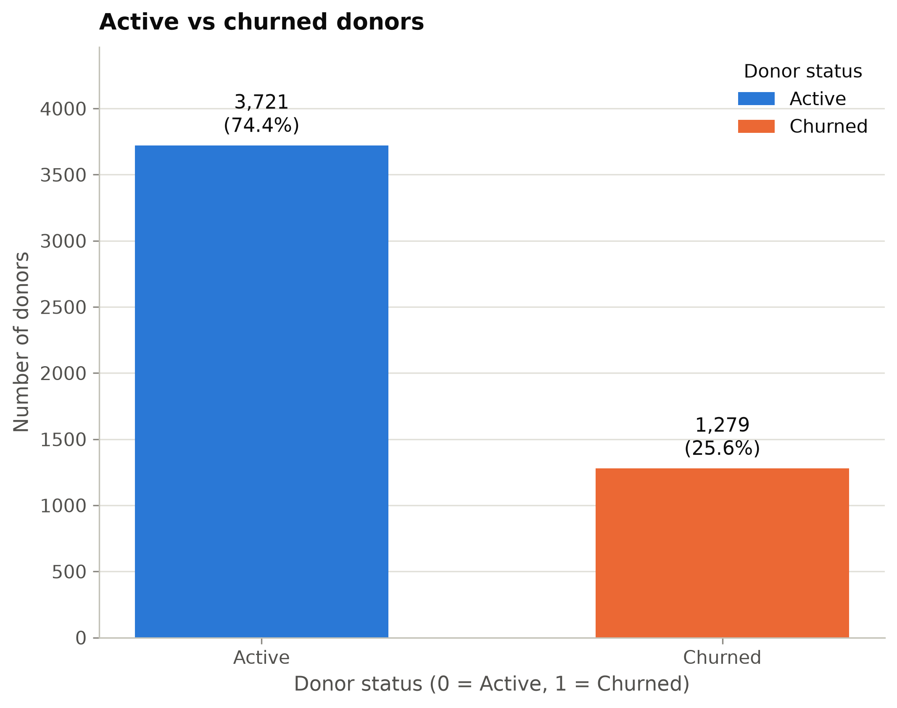

**Donation frequency**
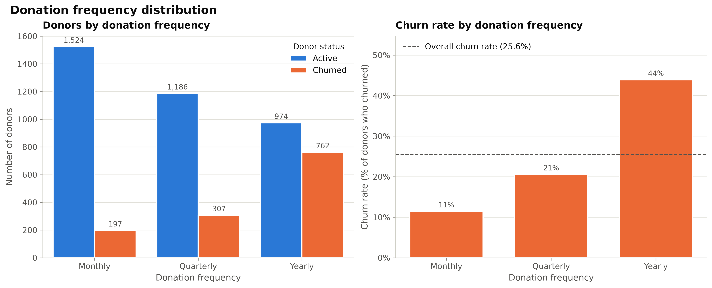

**Days since last donation (recency)**
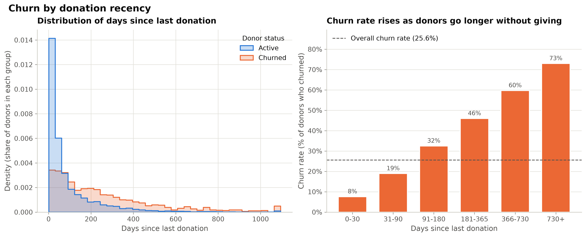

**Donation amounts**
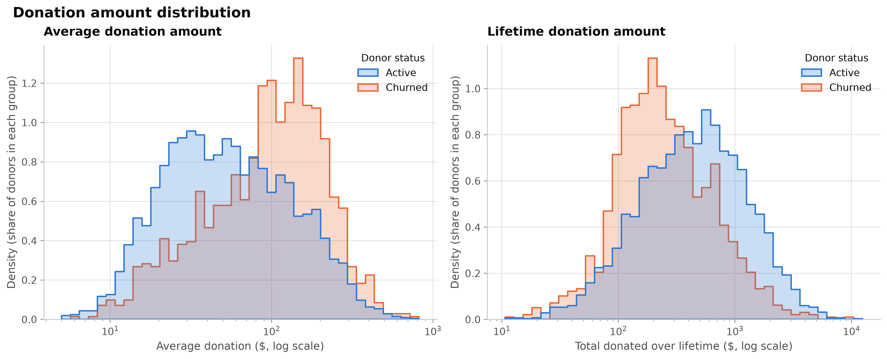

**Email engagement vs churn**
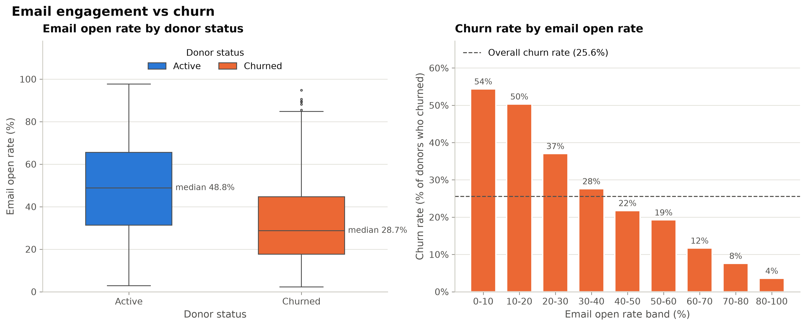

**Campaign response vs churn**
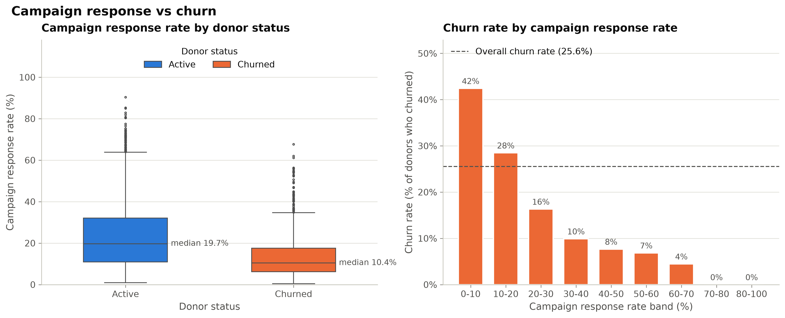

**Donor age**
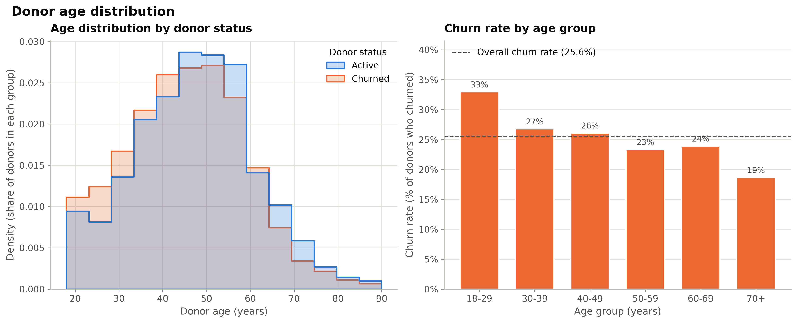

**Correlation heatmap**
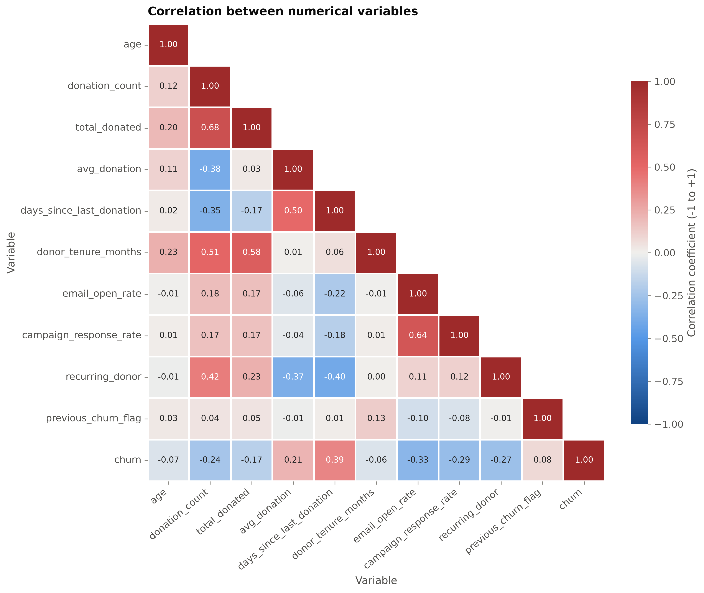

### Model evaluation

**Confusion matrix**
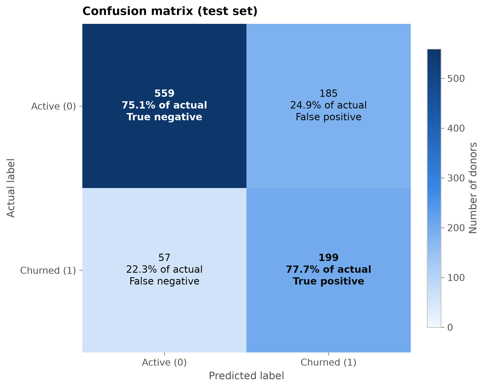

**ROC curve**
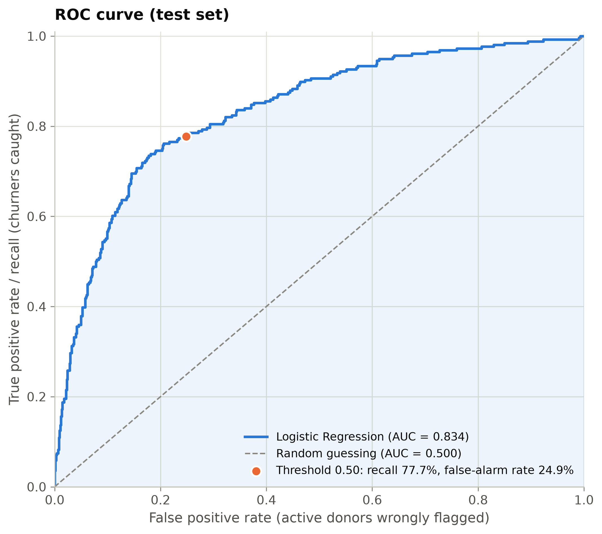

**Model metrics comparison**
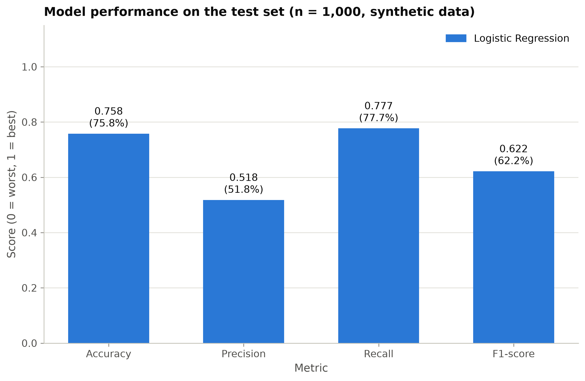

**Feature coefficients (what drives the predictions)**
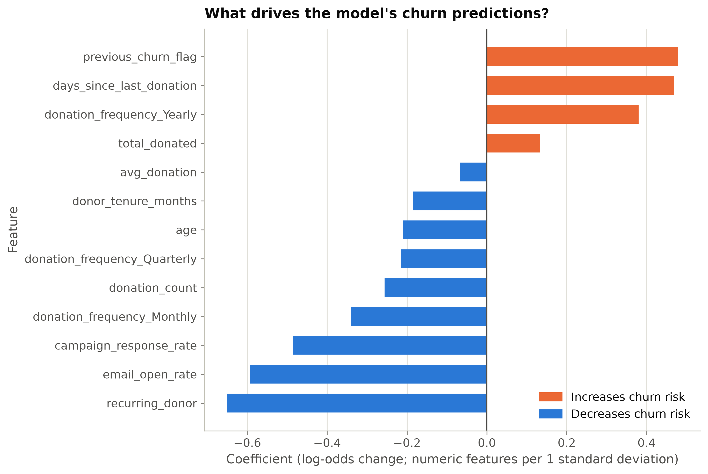

## 15. Project structure

```
donor-churn-prediction-using-python-scikit-learn/
├── data/
│   ├── raw/
│   │   └── donors.csv                  # generated synthetic dataset
│   └── processed/
│       ├── donors_clean.csv            # cleaned data (python -m src.preprocess)
│       ├── train.csv                   # 80% training split (python -m src.train)
│       └── test.csv                    # 20% untouched test split
├── models/
│   └── donor_churn_model.joblib        # trained pipeline (preprocessing + model)
├── notebooks/
│   └── exploratory_analysis.ipynb      # interactive EDA
├── reports/
│   ├── figures/                        # all PNG charts
│   ├── metrics.json                    # machine-readable metrics
│   └── model_evaluation.txt            # full evaluation report
├── src/
│   ├── __init__.py
│   ├── config.py                       # paths, column names, constants
│   ├── generate_dataset.py             # synthetic data generator
│   ├── preprocess.py                   # validation, cleaning, preprocessing pipeline
│   ├── eda.py                          # statistics and EDA charts
│   ├── train.py                        # model pipeline and training
│   ├── evaluate.py                     # metrics, charts, report
│   ├── predict.py                      # predict_donor_churn() and CLI
│   ├── model_io.py                     # save/load the model with Joblib
│   └── visualization.py                # shared chart style
├── tests/
│   ├── conftest.py                     # shared fixtures (small dataset, temp model)
│   ├── test_dataset.py
│   ├── test_preprocessing.py
│   ├── test_model.py
│   ├── test_prediction.py
│   └── test_eda.py
├── pytest.ini
├── requirements.txt
├── README.md
└── .gitignore
```

## 16. Limitations and ethical considerations

### Limitations

* **Synthetic data.** The relationships in the data were *designed* (see section 4). Real donor
  behaviour is more complex, and a real model would need real, carefully governed data.
* **Probabilities are risk scores, not exact chances.** `class_weight="balanced"` shifts predicted
  probabilities upwards (the average predicted probability is higher than the real 25.6% churn rate).
  Use them to *rank* donors. If calibrated probabilities are needed, use `CalibratedClassifierCV`.
* **Illustrative risk bands.** The 30% / 60% thresholds are examples, not tested policy.
* **One simple model, no tuning.** No cross-validation or hyperparameter search is done; the goal is
  clarity. Tree-based models or engineered features (for example "days overdue relative to the usual
  giving rhythm") may perform better.
* **Correlation is not causation.** For example, `avg_donation` is positively correlated with churn only
  because yearly donors give larger single gifts *and* churn more. The model predicts; it does not
  explain why a donor leaves or prove that an action will keep them.
* **EDA uses the full dataset.** This is descriptive only and no modelling decision was tuned on the test
  set, but in a stricter project EDA would be done on the training split only.
* **Snapshot in time.** Donor behaviour changes (economy, campaigns, world events). A real model must be
  monitored and retrained when its performance drifts.

### Ethical considerations

* **Privacy.** Real donor data is personal data. Use it only with a lawful basis and consent where
  required (for example under GDPR), minimise what you collect, and secure it.
* **Fairness.** The model uses `age`. Check that predictions and resulting actions do not treat groups
  unfairly; consider removing sensitive attributes or auditing outcomes by group.
* **Respectful use.** A churn score should help an organisation *serve* donors better (thank them,
  report impact, ask about preferences), never to pressure or manipulate them.
* **Human in the loop.** Predictions should support, not replace, the judgement of fundraising staff.
* **Transparency.** Logistic Regression was chosen partly because its coefficients are easy to explain
  (see the feature coefficients chart and `reports/model_evaluation.txt`).
